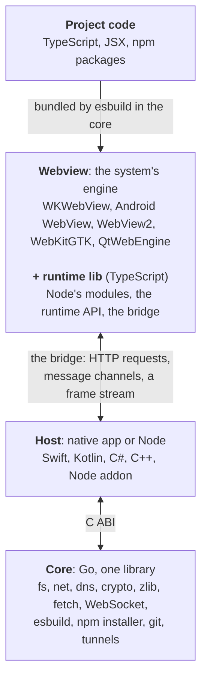
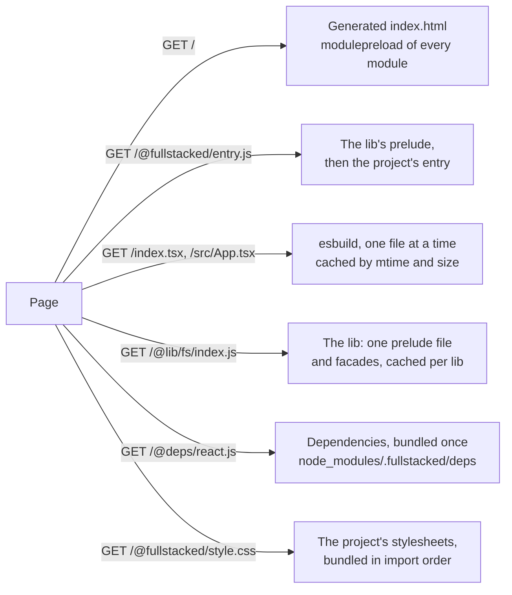

# Architecture

FullStacked runs JavaScript projects with Node's APIs on any device, including iOS and Android, where neither Node nor a JavaScript engine of your own may run. It has three parts:



- **The core** (`core/`) is a Go library with a C ABI, built as a static or shared library for each platform. It does everything that needs the system or heavy computation: files, sockets, DNS, HTTP, TLS, compression, cryptography, bundling (esbuild), package installs and git (go-git). One core serves every project open in the app.
- **The host** (`platform/`) is a thin native app: a window with a webview, which serves the page's requests to the core and relays the page's calls. It's about 220 lines of bridge per platform. See [Platforms](#platforms).
- **The runtime lib** (`core/internal/bundle/lib`) is TypeScript embedded in the core. The bundler injects it into every project: Node's built-ins, written for the webview ([Node.js compatibility](node/index.md)), the runtime API ([Runtime API](api/index.md)) and the bridge client ([The bridge](bridge.md)).

JavaScript always runs on the platform's own engine: JavaScriptCore on Apple and WebKitGTK, V8 on Android, WebView2 and QtWebEngine. FullStacked doesn't ship a JavaScript engine. That's what lets it run on iOS, and it keeps the apps small.

## Contexts

A **context** is one running project in the core. Every bridge call carries its context id (one byte), and the core resolves everything against it:

| Field                | Meaning                                                                      |
| -------------------- | ---------------------------------------------------------------------------- |
| `Directories.Root`   | The project directory. `/` for `fs`, `path` and `process.cwd()`.             |
| `Directories.Build`  | Where the page is served from first: `<root>/out`                            |
| `Cwd`                | `process.cwd()`, relative to the root (starts at `/`)                        |
| `Env`                | `process.env`                                                                |
| Streams              | Open sockets, file streams, fetches, and the [frame queue](bridge.md#frames) |
| Crypto, zlib handles | Hash, cipher and compressor states                                           |
| Plugins              | Registered [plugins](api/plugin.md), queued deep links                       |
| Git credentials      | Cached per host                                                              |

A host creates the first context at startup (`start(root, build)`). For the apps, that context runs the shell. For the CLI, it's the CLI's own process. New contexts come from [`run`](api/run.md). A page and its workers share one context. Ids are one byte, which caps the number of contexts open at once at 256.

A context ends when its window closes, or a second after it calls `process.exit()`. Then the core closes every stream it opened (sockets, reads, fetches, WebSockets) and frees its handles.

### The sandbox

Every path a project passes to the core is resolved inside its context's root: `/` is the project directory, and a path that climbs above it is clamped to it. A project can read and write its own files and nothing else on the device through `fs`, `git`, `packages` or `bundle`. [`run`](api/run.md) follows the same rule without clamping: a context only starts contexts in its root or a directory under it, and the core refuses any other directory. The app's shell is the context whose root is the app's projects directory, which is how it manages every project.

The sandbox applies to files. Network access (`net`, `fetch`, `dgram`) is unrestricted.

## A project's lifecycle

1. **Bundle.** [`bundle`](api/bundle.md) runs esbuild in the core on the project's entrypoint. Built-in imports resolve to the embedded lib, and npm imports to `node_modules`. The output goes to `out/`, with a generated `index.html`. In [transform mode](#transform-mode) (beta), [`prepare`](api/bundle.md#prepare) takes this step's place and nothing is written to `out/`.
2. **Run.** [`run`](api/run.md) creates a context with the project as its root.
3. **Open.** The host opens a window on a URL of its own (`fs://localhost`, `http://localhost`, or `http://localhost:<port>` for the CLI) and binds it to the context.
4. **Load.** The page fetches `out/index.html` and the bundle. The bundle's first import (`fullstacked`) initializes the bridge: it reads its context id from `GET /ctx`, detects the host's transports, attaches the frame stream, replaces `fetch` and `WebSocket`, installs `process`, `Buffer` and `setImmediate`, and restores the window size. Then the project's code runs. A bundle the page loads later uses the same bridge (see [Several bundles in a page](bridge.md#several-bundles-in-a-page)).
5. **Run.** Each core-backed call crosses [the bridge](bridge.md): a sync call blocks the page like Node's sync APIs do, and an async call resolves when the core answers. Data that flows over time comes back as [streams](bridge.md#streams).
6. **Exit.** Closing the window, or `process.exit()`, ends the context.

## Transform mode

_Beta._ Bundle mode builds the whole project, its npm packages included, before the page opens: every start pays for bundling packages that never changed. **Transform mode** serves the project from its sources instead. The page asks for each module, the core builds that file on its own, and the npm dependencies are built once and cached. A context runs in one mode, chosen at [`run`](api/run.md#mode). Bundle mode stays the default, and [`bundle`](api/bundle.md#bundle) and `fullstacked --build` are unchanged.



**Prepare.** [`prepare`](api/bundle.md#prepare) (the CLI's `--transform`, the app's `run --transform`) runs before the page opens:

1. **The lib.** The runtime lib as ES modules, built once per lib and kept in the user's cache folder. Every page loads the lib's prelude (the `fullstacked` module: the bridge, `process`, `Buffer`, timers…). It is one file, `/@lib/fullstacked/index.js`, which also exports a namespace of each lib file it holds. A lib module among them (`fs`, `path`, `events`…) is a facade over that namespace. The other modules (`crypto`, `zlib`, `git`…) are built split, and read what they share with the prelude from it. Every importer gets the same URLs, so there's one bridge per page.
2. **The scan.** One esbuild build of the project from its entry, with every package, lib module and file left external. It lists the project's modules and the packages it imports, with the names it imports from each. Its errors are the ones a bundle would report, with the same messages. It also reads the project's stylesheets (so build plugins see what CSS imports, like `@import "tailwindcss"`), and its CSS output is a bundle's `index.css`.
3. **The dependencies.** One esbuild build with an entry per package specifier the project imports, split so that packages share chunks and each package loads once per page. Each entry is a facade that imports only the names the project uses, so esbuild tree-shakes the package as in a bundle. A namespace import used other than as `ns.name`, `import()`, `export *` or `require()` keeps the whole package. A module imports an ES module package as an ES module that exports these names, so a default import gets the package's default export; a CommonJS package (by extension, its package's `"type"`, else its syntax, as esbuild reads it) as its `module.exports`, through the same interop as a bundle, so in a `"type": "module"` project a default import gets the whole of it (Node's rule). The output is cached in `node_modules/.fullstacked/deps` (creating it leaves `node_modules`' modification time as it was, so the next [install](api/packages.md) still trusts what is installed), keyed by `package.json`, the lockfile (or npm's `node_modules/.package-lock.json`), the core, esbuild, the specifiers and the names. A warm start does no dependency build.
4. **The build plugins** run with the scan's files, and their outputs are linked in the page.
5. **The modules.** Every module the scan found is transformed in parallel, so the page's requests are memory reads. On the Node CLI, where requests are answered on Node's event loop, nothing is built while the page loads.

**A module** is built by esbuild alone, with bundling on and every import left external, rewritten to its page path. esbuild resolves imports exactly as in a bundle (extensions, index files, `tsconfig.json` `paths`, `exports` and `browser` fields) and applies the project's `tsconfig.json`. Each import goes to:

| Import                         | Page path                                                                         |
| ------------------------------ | --------------------------------------------------------------------------------- |
| A module of the project        | `/src/App.tsx`, transformed                                                       |
| A lib module (`fs`, `node:fs`) | `/@lib/fs/index.js`                                                               |
| An npm package                 | `/@deps/<specifier>.js`, through a CommonJS proxy                                 |
| CSS                            | Already in `/@fullstacked/style.css`. The import's value is the file's URL.       |
| JSON                           | `/@import/data.json`: `export default` its value                                  |
| An image or another file       | `/@import/logo.png`: `export default "/logo.png"`, as the file loader of a bundle |

A package hoisted above the project (npm workspaces put a workspace's packages in the `node_modules` of the folder above) is addressed as the project's own `/node_modules/<path>`: a page path under `/node_modules/` the project doesn't have is looked up in the `node_modules` of each folder above it, the way Node's resolution finds it. Its CSS, and the fonts and images that CSS points to, load like a local package's.

A module outside of the project that it imports by path (`../shared/greet.ts`, which a bundle includes) is built with the dependencies, and an edit of that file builds them again. The page never reads a file outside of the project directly.

**CommonJS packages** keep a bundle's interop. Each dependency facade's default export is the package as a bundle's interop sees it, marked `__esModule`. A module of the project reaches it through a tiny CommonJS proxy (`module.exports = require(<esm proxy>).default`), so esbuild writes the same interop code it writes in a bundle: `import { useState } from "react"`, `import cx from "classnames"` (`module.exports = fn`), `import * as R`, `import()` and `require()` all get what they get in a bundle. No `require` runs in the page.

**The page** is a generated `index.html`. It links the dependencies' and the project's stylesheets, then the plugins' outputs. It preloads (`modulepreload`) every module it will load, so the browser asks for them at once instead of one level of imports after the other. Then it loads `/@fullstacked/entry.js`, which imports the lib's prelude, waits for it (the bridge initializes with a top-level await), then imports the project's entry. Only the entry waits for the [first paint](project-structure.md#first-paint). A worker created with `worker_threads` loads `/@fullstacked/worker/<path>`, the same prelude around its module.

**Edits.** A request transforms a module again when its file changed. Reloading the page scans the project again if one of its files changed: an import of a package or name not seen yet rebuilds the dependencies, and the build plugins run again while the context that registered them runs. A module that fails to build is served as a module that logs its errors and shows them over the page, instead of a blank page.

**Differences with bundle mode.** The entry's code is run like every other module, so `tsconfig.json` applies to it too: a bundle reads its entry through esbuild's stdin, which ignores `tsconfig.json` (`jsx`, decorators, `paths`) and the `"type": "module"` of `package.json` (in a bundle, a default import of a CommonJS package marked `__esModule` gets its `default` in the entry, the whole `module.exports` in other files; transform mode follows the second rule in every file). Error lines in the entry are exact, where a bundle's are one line off (it prepends `import "fullstacked"`). A project file that is CommonJS (`module.exports` in a `.js`) is served with a default export only.

## Platforms

| Platform                | Webview             | Page origin                       | Projects directory           | Calls                              |
| ----------------------- | ------------------- | --------------------------------- | ---------------------------- | ---------------------------------- |
| macOS, iOS, iPadOS      | WKWebView (SwiftUI) | `fs://localhost` (scheme handler) | The app's Documents          | WebKit message handler + requests  |
| Android, ChromeOS       | Android WebView     | `http://localhost` (intercepted)  | `filesDir/projects`          | JavascriptInterface + web messages |
| Windows 10/11           | WebView2 (WinUI)    | `http://localhost` (intercepted)  | `%LOCALAPPDATA%\fullstacked` | Shared buffer + web messages       |
| Linux                   | WebKitGTK           | `fs://` (scheme)                  | `~/FullStacked`              | WebKit message handler + requests  |
| Linux                   | QtWebEngine         | `fs://` (scheme handler)          | `~/FullStacked`              | QWebChannel + messages             |
| Node.js ([CLI](cli.md)) | your browser        | `http://localhost:9000+`          | the current directory        | HTTP requests                      |

Every platform starts in _safe mode_ on request, which ignores `initialDirectory`: <kbd>Cmd+Shift+T</kbd> on Apple, <kbd>Ctrl+Shift+T</kbd> elsewhere, a three-finger hold on touch screens, `--safe` on Linux and in the CLI. See [Safe mode](getting-started.md#safe-mode).

The native apps ship the shell, the project in `shell/` built to `shell/out`, as their main page. The shell is a terminal (xterm.js) with commands for git, npm, bundling and running projects, all of it written in TypeScript over the runtime API.

### Back navigation

On Android and ChromeOS, the system back button and back gesture call `globalThis.back()` in the window on top. A project binds back by defining it:

```ts
globalThis.back = () => {
    // close a dialog, go up a view…
};
```

- A fullscreen element (a `<video>`'s fullscreen, `requestFullscreen()`) is left first, and `back` is not called for that press.
- Without `back`, the press does nothing: it doesn't go back in the page's history, close the window or leave the app. To follow the history, define `globalThis.back = () => history.back()`.
- The other platforms never call `back`.

## Repository layout

| Path                    | Contents                                                                                                                                                                 |
| ----------------------- | ------------------------------------------------------------------------------------------------------------------------------------------------------------------------ |
| `core/`                 | The Go core: `main.go` (C ABI), `internal/<module>` (one package per bridge module), `internal/bundle/lib` (the runtime lib, TypeScript), `build/` (per-platform builds) |
| `core/types/`, `types/` | Shared Go types and the generator of their TypeScript mirrors (`npm run generate-types`)                                                                                 |
| `platform/`             | Hosts: `apple`, `android`, `windows`, `linux`, `node` (CLI and addon), `@fullstacked/*` (prebuilt core packages)                                                         |
| `shell/`                | The app's terminal UI, itself a FullStacked project (git submodule)                                                                                                      |
| `plugins/`              | The `@fullstacked/tailwindcss` and `@fullstacked/sass` build plugins, and the shell's onboarding (git submodules)                                                        |
| `test/`                 | Node test runner suites: unit, end-to-end in Node, and integration in a real webview (Puppeteer)                                                                         |
| `docs/`                 | This site                                                                                                                                                                |
