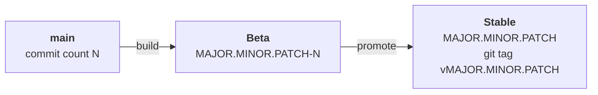

# Releases

FullStacked ships on two channels. **Beta** gets a build of `main` on every platform. **Stable** gets a beta build that was promoted, under a version without its build number.



## Versions

`MAJOR.MINOR.PATCH` is the `version` in the root `package.json`. `N` is the build number, `git rev-list --count main`: every commit on `main` raises it, so each build is higher than the last.

| Channel | Version               | Example      | Built from                                    |
| ------- | --------------------- | ------------ | --------------------------------------------- |
| Beta    | `MAJOR.MINOR.PATCH-N` | `1.0.0-1860` | `main` only. Other branches never go to beta. |
| Stable  | `MAJOR.MINOR.PATCH`   | `1.0.0`      | The commit of the promoted beta build         |

A promoted build drops its `-N`. The promoted commit is tagged `vMAJOR.MINOR.PATCH` (`git tag v1.0.0 <commit>`, then `git push origin v1.0.0`), so every stable release can be found and rebuilt from GitHub.

The npm and Linux builds get their version from `getFullVersion` in `version.ts`: the beta version by default, the stable one with `FULLSTACKED_RELEASE=1` (`platform/linux/publish.js --release` sets it). Publishing refuses a beta that isn't on `main`, and a stable release whose commit doesn't carry its `vMAJOR.MINOR.PATCH` tag.

After a release, the next change bumps the version in `package.json` by its impact on existing projects. MINOR is for changes a project may need to adapt to: new features, changed behavior, removed APIs. PATCH is for fixes and internal changes that leave projects as they are. MAJOR marks a new generation of FullStacked, like v1. Builds after that are betas of the next version (`1.0.1-N` or `1.1.0-N`).

## Platforms

| Platform   | Beta                                              | Stable                                    |
| ---------- | ------------------------------------------------- | ----------------------------------------- |
| Apple      | TestFlight                                        | App Store                                 |
| Android    | Google Play test tracks                           | Google Play                               |
| Windows    | Microsoft Store, unlisted app                     | Microsoft Store, listed app               |
| Linux      | `files.fullstacked.org`, pointed to by `beta.txt` | `files.fullstacked.org`, by `release.txt` |
| Node (npm) | dist-tag `beta`                                   | dist-tag `latest`                         |

### Apple

One app, bundle id `org.fullstacked`, for iOS, iPadOS and macOS. A build sets `MARKETING_VERSION` to `MAJOR.MINOR.PATCH` and `CURRENT_PROJECT_VERSION` to `N`. Betas go to TestFlight. Promoting submits the same build for App Store review, so nothing is rebuilt: the App Store shows `MAJOR.MINOR.PATCH`, and `N` stays the build number.

Once a version is approved, App Store Connect takes no more builds for it. Builds after a release need the bumped version.

### Android

One app, `org.fullstacked`. A build sets `versionName` to `MAJOR.MINOR.PATCH` and `versionCode` to `N`. Betas go to the Google Play test tracks. Promoting moves the same release to production, so nothing is rebuilt.

### Windows

Two apps in the Microsoft Store, since one Store app can't carry both channels:

| Channel | Package identity name                    | Store ID                                                         | Listing  |
| ------- | ---------------------------------------- | ---------------------------------------------------------------- | -------- |
| Beta    | `Charles-PhilippeLepage.FullStackedBeta` | [`9N9BCQSWWZ79`](https://apps.microsoft.com/detail/9N9BCQSWWZ79) | Unlisted |
| Stable  | `Charles-PhilippeLepage.624E9245A1B`     | [`9P1TF0N0VHNC`](https://apps.microsoft.com/detail/9P1TF0N0VHNC) | Listed   |

A build writes the channel's identity name into `Package.appxmanifest`. The package version is `MAJOR.MINOR.N.0`: the Store reserves the fourth number, which must be `0`, so the patch doesn't fit, and `N` alone keeps the versions increasing. Promoting rebuilds the tagged commit with the stable identity and uploads it to the stable app.

### Linux

Four `.deb` packages and four portable `.tar.xz` archives (arm64 and x64, GTK and Qt), built and uploaded by `platform/linux/publish.js`:

```text
https://files.fullstacked.org/releases/<version>/fullstacked-<version>-linux-<arch>-<gtk|qt>.<deb|tar.xz>
```

Two plain-text files name each channel's current version: `releases/beta.txt` and `releases/release.txt`. The download page at [fullstacked.org/download](https://fullstacked.org/download) reads them to build its links. Promoting runs `publish.js --release` on the tagged commit: it builds `MAJOR.MINOR.PATCH`, uploads it under `releases/MAJOR.MINOR.PATCH/` and writes that version to `release.txt`.

dpkg sorts a version without a revision below the same version with one: `1.0.0` comes before `1.0.0-1860`. Moving a beta install to the stable package of the same version is a downgrade for apt.

### Node (npm)

The `fullstacked` package and its six prebuilt cores, `@fullstacked/<platform>-<arch>` (darwin, linux and win32, on arm64 and x64), all get the same version. Betas are published as `MAJOR.MINOR.PATCH-N` with the `beta` dist-tag. Stable releases are published as `MAJOR.MINOR.PATCH` with the `latest` dist-tag. npm can't rename a version, so promoting publishes the tagged commit again, built with `FULLSTACKED_RELEASE=1`.

```bash
npm install -g fullstacked@beta
```

```bash
npm install -g fullstacked
```

In semver, `1.0.0-1860` sorts below `1.0.0`, so a range like `^1.0.0` only matches stable releases.
